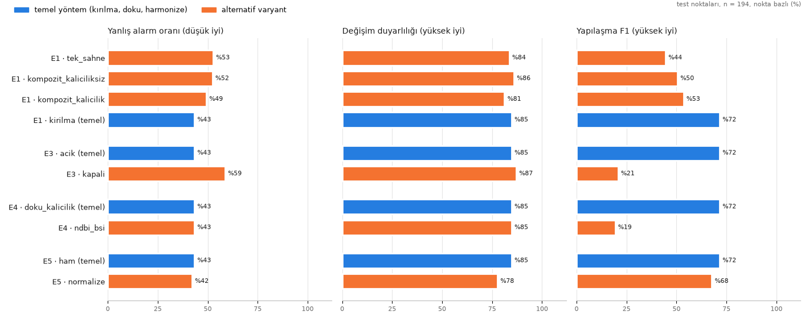

# TR-ChangeWatch

Ankara'daki seçili bölgelerde Sentinel-2 L2A ile yapılaşma ve arazi örtüsü değişimini kanıtıyla ve güven düzeyiyle haritalayan değişim izleme sistemi. Kapsam ve mimari: [PROJECT_SPEC.md](PROJECT_SPEC.md).

> Geliştirme sürüyor (Faz 3 hazırlığı). Kırılma yöntemi ve yapılaşma/bitki kaybı kuralları v1 için donduruldu; su kuralı Gölbaşı'nda tasarlandı; doğrulama noktaları etiketlenmeyi bekliyor.

## Kurulum

```bash
py -3.12 -m venv .venv
.venv\Scripts\python -m pip install -e ".[dev]"
changewatch --help
```

Ham veri önbelleği ve ara çıktılar `config/settings.yaml` içindeki `paths.cache_dir` klasörüne yazılır (harici disk). Repoya yalnızca kod, GeoJSON, JSON, CSV ve küçük PNG girer.

## Komutlar

```bash
changewatch check-aois                                  # AOI alan/sınır kontrolü
changewatch scenes      --aoi incek --years 2017-2026   # sahne/bulut/baseline özeti (indirme yok)
changewatch fetch       --aoi incek                     # AOI penceresini önbelleğe indir (20 m + 10 m B08)
changewatch composite   --aoi incek                     # harmonizasyon + SCL maskesi + medyan kompozit + sahne bazında doku
changewatch indices     --aoi incek --years 2017 2024   # NDVI, NDBI, MNDWI, BSI, doku (GeoTIFF + PNG)
changewatch detect      --aoi incek                     # kırılma noktası (varsayılan) → changes.geojson + izleme.geojson
changewatch detect      --aoi incek --method pairs      # ardışık yıl çiftleri (E1 karşılaştırması için)
changewatch water       --aoi golbasi                   # yıllık su maskesi, su alanı serisi ve grafiği
changewatch evaluate    --aoi incek --direct-years 2017 2024  # tür × yıl, yöntemler arası, tutarlılık
changewatch sample                                      # Faz 3: tabakalı örnekleme, labels.csv şablonu, çipler, QGIS yükleyici
changewatch label-prep                                  # kör etiketleme çipleri + Gölbaşı su doğrulama seti
changewatch label [--set su]                            # kör etiketleme arayüzü (talimat: validation/ETIKETLEME.md)
changewatch validate [--aoi incek]                      # AOI'ler ayrı ve birlikte: karışıklık matrisleri, Olofsson, su seti, hata paneli
changewatch experiments [--build]                       # E1, E3–E5 varyantları ve nokta tahminleri (E2 v2'de)
```

## Geliştirme ve test AOI'leri

Yöntem tasarımı ve eşik denemeleri yalnızca **geliştirme AOI'lerinde** yapılır: `incek` (yapılaşma, bitki kaybı) ve `golbasi` (su kuralı, Mogan Gölü). **Test AOI'leri** `baglica` ve `pursaklar`, yöntem dondurulana kadar hiç çalıştırılmaz (indirme dahil); dondurulduktan sonra hiçbir ayar değiştirilmeden çalıştırılır. Böylece test AOI'lerindeki sonuçlar, yöntemin o bölgelere göre ayarlanmamış olduğunu gösterir.

## Bulgu: İncek'te NDBI ve BSI ters çalışıyor

Literatürde yapılaşma için sık kullanılan "NDBI artışı" İncek'te geçerli değil. Bozkır ve sürülmüş tarla, NDBI ve BSI'de yerleşimden **daha yüksek** değer veriyor (yerleşimde bahçe, ağaç ve kiremit çatı var). Bu yüzden bozkırın konuta dönüşmesi NDBI ve BSI'yi **düşürüyor**.

| 2024 yaz kompoziti (medyan) | NDVI | NDBI | BSI |
|---|---|---|---|
| Yerleşim (doku > 0,05) | 0,160 | 0,014 | 0,078 |
| Bozkır/tarla (doku < 0,01) | 0,205 | 0,121 | 0,174 |

| 2017→2024 farkı (medyan) | dNDVI | dNDBI | dBSI | dMNDWI |
|---|---|---|---|---|
| Doku düşükten yükseğe çıkan pikseller (AOI'nin %5,4'ü) | −0,071 | −0,040 (%64'ü düşüş) | −0,038 (%69'u düşüş) | +0,111 |
| Dokusu iki yılda da düşük kalan pikseller | +0,013 | −0,005 | −0,002 | −0,005 |

Bu ölçüm keşif amaçlıdır; doğrulama noktası kullanılmadı ve eşik ayarlanmadı. Sonuç olarak yapılaşma kuralının birincil kanıtı **doku artışı + kalıcılık** oldu; NDVI, NDBI ve BSI farkları işaretli değerleriyle kanıt alanı olarak tutuluyor. İki kuralın doğrulama noktalarındaki karşılaştırması deney **E4**'te yapılacak.

## Yöntem geçişi: ardışık yıl çiftlerinden kırılma noktasına

İlk yöntem her ardışık yıl çiftinde (2017→2018 … 2025→2026) CVA büyüklüğü ve doku farkını Otsu ile eşikleyip bir sonraki yılda "geri dönmüyor mu" diye kalıcılık arıyordu. İncek'te iki yapısal sorun çıktı:

- **Otsu yıllık farklarda gürültüyü bölüyor.** Gerçek değişim alanın birkaç yüzdesiyken her yıl alanın %7–19'u aday oldu; 9 yılda AOI'nin %47'si en az bir kez "değişti".
- **Kalıcılık testi tarla rotasyonunu elemiyor.** Her yıl farklı ürün ekilen tarla "geri dönmediği" için kalıcı sayıldı.

Bu yüzden LandTrendr/BFAST'ın basitleştirilmiş bir hâline geçildi: her pikselin 2017–2026 serisinde (bantlar + doku, her biri kendi gürültüsüyle z-ölçekli) tek bir basamak aranır; kırılma yılı parça içi sapmayı en aza indiren yıldır, aday için basamak gürültünün k katını aşmalıdır. Yıl yıl değişen tarlanın parça içi yayılımı büyük olduğu için skoru düşük kalır; kalıcılık yöntemin içindedir.

| İncek, 2017–2026 | Ardışık çift | Kırılma noktası |
|---|---|---|
| Yapılaşma (ha) | 1 545 | 417 (+ 2026 izleme 117) |
| Tüm türler, ayak izi (ha) | 2 826 | 518 |
| Doğrudan 2017→2024 doku artışlı adayla örtüşme (yöntemin içeride kalan payı) | %36 | %59 |

Ardışık çift yöntemi silinmedi (`--method pairs`); doğrulama noktalarında E1'de karşılaştırılacak.

## Bulgu: Gölbaşı su alanındaki artışın çoğu çatı ve seralardan

İlk su kuralı "MNDWI > 0 olan her piksel su" diyordu. Gölbaşı'nda bu seri 2017→2025 arasında **+37,6 ha** artış gösteriyordu. Su yalnızca ≥ 5 ha bağlı su kütlelerine ait pikseller olarak tanımlanınca artış **+12,6 ha**'ya iniyor. Aradaki fark, MNDWI > 0 veren küçük parçalardan (çatı, sera, gölcük) geliyor ve bu parçalar yıllar içinde 8 ha'dan 33 ha'ya büyüyor; büyük olasılıkla Gölbaşı'ndaki yapılaşmayla birlikte.

| Yıl | Su (≥ 5 ha kütleler) | Eski seri (tüm MNDWI > 0) | Elenen küçük parçalar |
|---|---|---|---|
| 2017 | 521 | 529 | 8 |
| 2021 | 546 | 561 | 15 |
| 2024 | 528 | 559 | 31 |
| 2025 | 534 | 567 | 33 |

Grafik `changewatch water --aoi golbasi` ile üretilir (eski seri kesikli). 2021'deki sıçramanın bir kısmı göl suyunun renk değişiminden (alg/bulanıklık) gelebilir; göl içi renk değişimi su kazanımı sayılmaz (su kütlelerinin iç delikleri doldurulur, kazanım/kayıp yalnızca kıyı şeridinde aranır).

## Doğrulama sonuçları (Faz 3, geliştirme AOI'leri)

Kör etiketlenmiş **test** noktaları (kalibrasyon noktaları kullanılmadı, eşik ayarı yapılmadı; yöntem dondurulmuş). 197 test noktasından 3'ü "emin değilim" olarak işaretlendi ve metriklere katılmadı → n = 194. Harita: kırılma yöntemi, kalıcı katman. `changewatch validate` ile üretilir (`validation/metrics_test.json`).

| | incek | golbasi | birlikte |
|---|---|---|---|
| n (test) | 116 | 78 | 194 |
| Değişim / değişim yok: TP · FN · FP · TN | 55 · 8 · 24 · 29 | 17 · 5 · 31 · 25 | 72 · 13 · 55 · 54 |
| Değişim kesinliği / duyarlılığı | %70 / %87 | %35 / %77 | %57 / %85 |
| Yapılaşma kesinliği / duyarlılığı (nokta bazlı) | %71 / %71 | %71 / %75 | %71 / %72 |
| Olofsson genel doğruluk (± %95 GA) | %76 ± 12 | %82 ± 13 | %79 ± 9 |
| Haritadaki yapılaşma (ha) | 418 | 147 | 564 |
| Kestirilen yapılaşma alanı (ha, ± %95 GA) | 1 340 ± 682 | 861 ± 700 | 2 239 ± 982 |
| Yapılaşma üretici doğruluğu, alan ağırlıklı | %22 ± 12 | %12 ± 10 | %18 ± 8 |
| Kırılma yılı isabeti: tam / ±1 yıl | %69 / %83 (54) | %56 / %88 (16) | %66 / %84 (70) |

Yıl isabeti yalnızca etiketinde yıl girilmiş ve hem etiketin hem haritanın "değişim" dediği noktalarda hesaplanır (parantez içinde n).

**Okuma:** Haritanın yapılaşma dediği yerlerin ~%71'i gerçekten yapılaşma; ama alan ağırlıklı kestirime göre gerçek yapılaşmanın yalnızca ~%18'i haritada. Bunun nedeni, "değişim yok" tabakasındaki 11 kaçırılmış yapılaşma noktasının her birinin ~164 ha temsil etmesi: küçük bir kaçırma oranı, çok geniş bir tabakada büyük bir alana karşılık geliyor. Güven aralıkları geniş (yapılaşma alanı ± 982 ha); "değişim yok" tabakasında daha fazla nokta etiketlenmeden alan kestirimi daraltılamaz.

### Su doğrulama seti

Gölbaşı'ndaki tüm su poligonları (16 poligon, 5,2 ha; kalıcı + izleme) birer noktayla etiketlendi. Bu set bir sayımdır, alan kestirimine katılmaz.

| tahmin türü | poligon | alan (ha) | etiket "değişim var" | etiket "değişim yok" |
|---|---|---|---|---|
| su_kazanimi | 7 | 2,88 | 0 | 7 |
| su_kaybi | 3 | 0,68 | 0 | 3 |
| sulak_alan_belirsiz | 6 | 1,68 | 0 | 6 |

16 poligonun hiçbiri etiketlemede değişim olarak doğrulanmadı: su katmanının kesinliği bu sette %0.

### Deneyler (E1, E3–E5)

`changewatch experiments` ile üretilir (`validation/experiments_test.json`). Aynı 194 test noktası; nokta bazlı (tabakalar temel haritadan çekildiği için diğer varyantlara Olofsson ağırlığı uygulanmaz). E2 (mevsim penceresi) v2'ye ertelendi.



| deney | varyant | genel doğruluk | yanlış alarm oranı | değişim kesinliği / duyarlılığı | yapılaşma kesinliği / duyarlılığı | yapılaşma F1 | yıl tam / ±1 |
|---|---|---|---|---|---|---|---|
| E1 | tek sahne (ardışık çift, kalıcılık yok) | %28 | %53 | %47 / %84 | %73 / %32 | %44 | %25 / %61 |
| E1 | medyan kompozit (ardışık çift, kalıcılık yok) | %30 | %52 | %48 / %86 | %72 / %39 | %50 | %37 / %70 |
| E1 | kompozit + kalıcılık (ardışık çift) | %38 | %49 | %51 / %81 | %76 / %41 | %53 | %40 / %75 |
| E1 | **kırılma noktası (temel)** | **%56** | **%43** | %57 / %85 | %71 / %72 | **%72** | **%66 / %84** |
| E3 | harmonizasyon kapalı | %8 | %59 | %41 / %87 | %75 / %12 | %21 | %21 / %51 |
| E4 | eski NDBI/BSI kuralı | %34 | %43 | %57 / %85 | %34 / %13 | %19 | %66 / %84 |
| E5 | normalize doku | %56 | %42 | %58 / %78 | %73 / %63 | %68 | %67 / %86 |

- **E1:** Tek sahneden kırılma yöntemine geçiş yanlış alarm oranını %53'ten %43'e indiriyor; asıl kazanç yapılaşma duyarlılığında (%32 → %72) ve yıl isabetinde (%25 → %66). Kalıcılık kuralı ardışık çift yönteminde yanlış alarmı yalnızca 3 puan azaltıyor.
- **E3:** Harmonizasyon kapalıyken yanlış alarm %59'a çıkıyor ve yapılaşma duyarlılığı %12'ye düşüyor; değişimlerin çoğu başka türe kayıyor.
- **E4:** Değişim/değişim yok kararı aynı (aynı kırılma maskesi); yalnızca tür kuralı farklı. NDBI/BSI kuralı yapılaşmanın %13'ünü yakalıyor, doku kuralı %72'sini: İncek'te NDBI'nin ters çalıştığı bulgusu doğrulama noktalarında da görülüyor.
- **E5:** Normalize doku yanlış alarmı değiştirmiyor (%42 / %43), yapılaşma duyarlılığını düşürüyor (%72 → %63). Yıl isabetinde fark ±1–2 puan: ham doku korunuyor.

### Ayrışmalar

Tüm test noktalarındaki ayrışmalar: yanlış alarm 55 (tahmin bitki kaybı 20, belirsiz 18, yapılaşma 16, su kazanımı 1), kaçırma 13 (yapılaşma 11, diğer 2), tür hatası 18. En önemli 10 ayrışma (temsil ettiği alana göre seçildi; her değişim/değişim yok hata grubundan en az bir nokta) aşağıda; çerçeveler tahmin edilen (turuncu) ve etiketteki (mavi) yılı gösterir.


## Bilinen sınırlamalar

- **04.00 öncesi baseline'larda parlak yüzeyler bulut sayılabiliyor.** 2017–2021 sahneleri (processing baseline 02.12 ve 03.00) bulutsuz günlerde bile parlak yüzeyleri (şantiye, yol, parlak çatı) SCL 8/9 (orta/yüksek olasılıklı bulut) olarak sınıflandırabiliyor. İncek yaz kompozitlerinde 2017–2021 arasında AOI piksellerinin %0,05–0,35'inde 3'ten az geçerli gözlem kaldı (2022 ve sonrasında %0); bu pikseller kompozitte boş bırakılır. Maske değiştirilmedi; bunun yerine her değişim poligonunda `dusuk_gozlem` kanıt alanı (önceki yıl kompozitindeki ortalama geçerli gözlem sayısı ve <3 gözlemli piksel oranı) raporlanır.
- **Son yıl sıçramaları kalıcı katmana sızabilir.** Kalıcı katman en az 2 yıllık "sonrası" ister; yalnızca son yılda (ör. 2026) sıçrayan bir piksel b = 2025'te yarım basamak gösterir ve tek tük pikseller kalıcı katmanda 2025 kırılması olarak geçebilir (MMU tekilleri büyük ölçüde atar). 2026 kırılmaları ayrı `izleme.geojson` katmanındadır.
- **Doku zamanla yukarı kayıyor.** İncek'te AOI doku medyanı 2017→2026 0,021 → 0,030; skoru düşük (değişmeyen) piksellerde de ~%15 artış var. 2025–2026'da sahne sayısı (20–21) 14'e indirildiğinde medyan değişmiyor (0,0289 / 0,0301), yani kayma sahne sayısından kaynaklanmıyor. Nedeni açık (bitki/ağaç büyümesi, yaygın kentleşme veya algılayıcı farkı olabilir); etkisi deney E5'te ölçülecek.
- **Tek değişkenli su kırılması gürültüye duyarlı.** MNDWI serisinde kırılma adayı tek başına AOI'nin büyük bir kısmını işaretler (Gölbaşı'nda ~2 000 ha); su katmanında özgüllüğü su kütlesi durumu değişimi ve kıyı şeridi koşulları sağlar (→ ~5 ha).
- **Su değişimleri doğrulama örneklemesinde neredeyse yok.** Su türleri Gölbaşı'nda toplam ~5 ha; tabaka alt sınırı yalnızca ≥ 20 ha tabakalara uygulandığı için su tabakaları 0–1 nokta aldı. Su kuralının doğruluğu bu örneklemeyle ölçülemez; bunun için ayrı su doğrulama seti etiketlendi (yukarıda).
- **Su kütlelerinin iç delikleri doldurulur.** Göl içinde MNDWI'yi düşüren renk/bulanıklık değişimi su kazanımı/kaybı üretmesin diye ≥ 5 ha su kütlelerinin içindeki boşluklar su sayılır. Yan etkisi: göl içindeki gerçek adalar da su olarak haritalanır (Mogan'da belirgin ada yok).
- Sahne düzeyindeki bulut oranı (`eo:cloud_cover`) 100×100 km MGRS karesine aittir, AOI'ye değil. Asıl temizlik piksel düzeyinde SCL maskesiyle yapılır.
