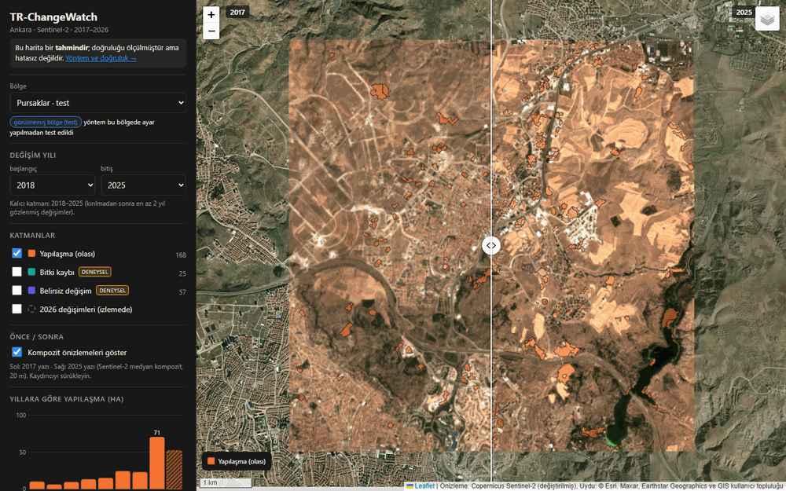
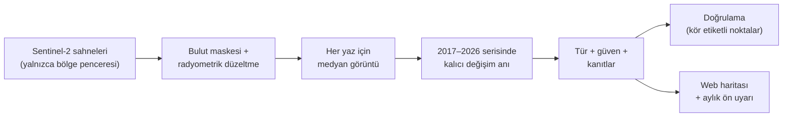

# TR-ChangeWatch

Ankara'da 2017–2026 arasındaki yapılaşma ve arazi değişimini Sentinel-2 uydu görüntüleriyle haritalayan, her değişimi kanıtı ve güven düzeyiyle gösteren ve doğruluğunu kendi topladığı noktalarla ölçen açık bir izleme sistemi.

**Canlı harita:** https://samettns.github.io/Tr-Changewatch/ · **Teknik rapor:** [docs/RAPOR.md](docs/RAPOR.md)

[](https://samettns.github.io/Tr-Changewatch/)

## Ne yapıyor?

- Ankara'daki dört **inceleme bölgesi** (kodda "AOI"; İncek–Kızılcaşar, Gölbaşı, Bağlıca–Etimesgut, Pursaklar) için her yazın bulutsuz Sentinel-2 görüntüsünü üretir. Görüntüler Planetary Computer'dan indirilir ve yalnızca bölgenin kendisi okunur.
- Her pikselin 2017–2026 serisinde kalıcı bir değişim anı arar. Bulduğu değişimleri **yapılaşma**, **bitki kaybı** veya **belirsiz** olarak sınıflandırır.
- Haritayı kör etiketlenmiş rastgele noktalarla doğrular. Yöntemi, hiç görmediği iki bölgede ayar değiştirmeden ayrıca test eder.
- Sonuçları statik bir web haritasında yayınlar. Son üç ayın değişim ön uyarıları her ay otomatik güncellenir.

## Ana sonuçlar

Kör etiketlenmiş test noktaları: geliştirme bölgelerinde 194, görülmemiş bölgelerde 110 nokta.

| | Yapılaşma F1 | Yanlış alarm oranı | Genel doğruluk (alan ağırlıklı) |
|---|---|---|---|
| Geliştirme bölgeleri (İncek, Gölbaşı) | %72 | %43 | %79 ± 9 |
| Görülmemiş test bölgeleri (Bağlıca, Pursaklar) | %50 | %39 | %74 ± 12 |
| Yapılaşma kuralı: NDBI/BSI artışı → doku + kırılma | %19 → %72 | %43 → %43 | – |
| Radyometrik düzeltme kapalı → açık | %21 → %72 | %59 → %43 | – |


Tüm tablolar, alan kestirimleri ve güven aralıkları: [Teknik rapor](docs/RAPOR.md).

## Öne çıkan bulgular

- **Yapılaşma NDBI'yi düşürüyor.** İncek'te bozkır ve sürülmüş tarla, yerleşimden daha yüksek NDBI/BSI veriyor. Bu yüzden "NDBI artışı" kuralı yapılaşmanın yalnızca %13'ünü yakaladı; doku kuralı %72'sini yakaladı. → [Rapor: NDBI bulgusu](docs/RAPOR.md#bulgu-ndbi-ve-bsi-ters-çalışıyor)
- **Yıl çiftlerinden tek kırılmaya geçmek işe yaradı.** Her yılı bir öncekiyle karşılaştırmak tarla rotasyonunu değişim sanıyordu. Tüm seride tek kalıcı basamak aramak yapılaşma duyarlılığını %32'den %72'ye, yıl isabetini %25'ten %66'ya çıkardı. → [Rapor: yöntem geçişi](docs/RAPOR.md#yöntem-geçişi-ardışık-yıl-çiftlerinden-kırılma-noktasına)
- **Görülmemiş bölgelerde değişim genelleşiyor, yapılaşma türü genelleşmiyor.** Bağlıca ve Pursaklar'da yapılaşma çoğunlukla sık yerleşimin içindeki küçük eklerden oluşuyor ve bunlar 20 m pikselde zor görünüyor. Bu nedenle yapılaşma F1'i %72'den %50'ye düştü. → [Rapor: görülmemiş bölgelerde test](docs/RAPOR.md#görülmemiş-bölgelerde-test)

## Nasıl çalışır?



## Kurulum ve kullanım

Python ≥ 3.11 gerekir. Aşağıdaki komutlar Windows içindir; Linux/macOS'ta `.venv/bin/python` kullanın.

```bash
py -3.12 -m venv .venv
.venv\Scripts\python -m pip install -e ".[dev]"
```

Ham veri ve ara çıktılar varsayılan olarak proje içindeki `./data` klasörüne yazılır. Başka bir disk kullanmak için `CHANGEWATCH_CACHE` ortam değişkenini ayarlayın. Örnek: `setx CHANGEWATCH_CACHE "D:\tr-changewatch-data"`, ardından yeni bir terminal açın.

```bash
changewatch fetch     --aoi incek      # bölge penceresini indir
changewatch composite --aoi incek      # yıllık bulutsuz medyan görüntüler
changewatch detect    --aoi incek      # değişim poligonları (GeoJSON)
changewatch validate                   # etiketlerden doğruluk tabloları
changewatch publish                    # web haritası verisi (docs/data)
python -m http.server 8000 --directory docs   # haritayı yerelde aç: http://localhost:8000
```

Tüm komutlar ve aylık izleme ayrıntıları: [Rapor: komutlar](docs/RAPOR.md#komutlar), [aylık izleme](docs/RAPOR.md#aylık-izleme).

## Sınırlamalar

- **Tek tek bina tespiti değildir.** Çözünürlük 20 m, en küçük alan 0,5 ha. Mevcut yerleşim içindeki küçük yapılar kaçırılır. Alan ağırlıklı kestirime göre gerçek yapılaşmanın yalnızca bir kısmı haritada görünür.
- **Yeni bölgelerde yapılaşma türü zayıflar.** F1 %72'den %50'ye düşer.
- **Bitki kaybı ve belirsiz katmanları deneyseldir** (varsayılan kapalı). Su değişim poligonları yayınlanmaz, çünkü göl kıyısında yanlış alarm verirler.
- **Aylık ön uyarılar doğrulanmamıştır.** Yıllık analizde doğrulanana kadar yalnızca ipucudur.

Tam liste: [Rapor: bilinen sınırlamalar](docs/RAPOR.md#bilinen-sınırlamalar).

## Veri ve atıflar

- Copernicus Sentinel-2 L2A (ESA): değiştirilmiş Copernicus Sentinel verisi, 2017–2026. Erişim: Microsoft Planetary Computer.
- Altlıklar: © OpenStreetMap katkıcıları (ODbL); uydu: © Esri ve sağlayıcıları. Harita kütüphanesi: Leaflet.
- Alan ağırlıklı doğruluk: Olofsson, P. vd. (2014), *Remote Sensing of Environment* 148, 42–57.

## Geliştirme notu

Geliştirmede yapay zekâ araçları kullanıldı (kod, analiz, dokümantasyon). Yöntem kararları, etiketleme ve sonuçların kontrolü proje sahibine aittir.
