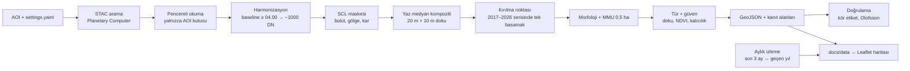
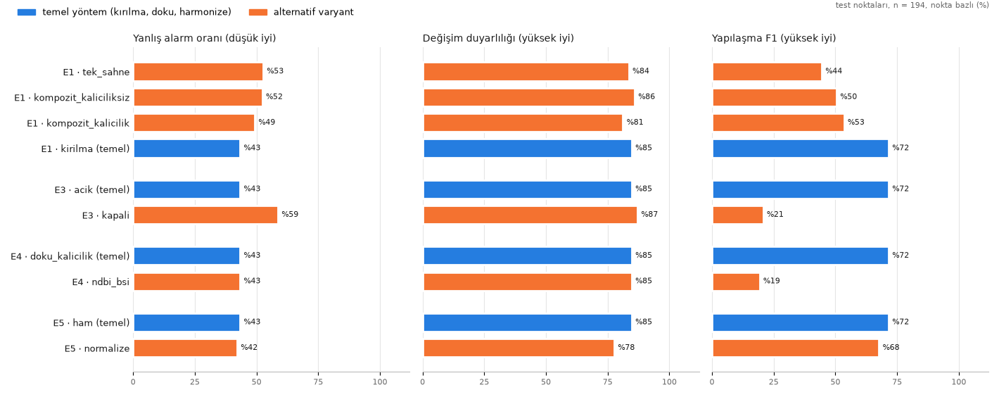
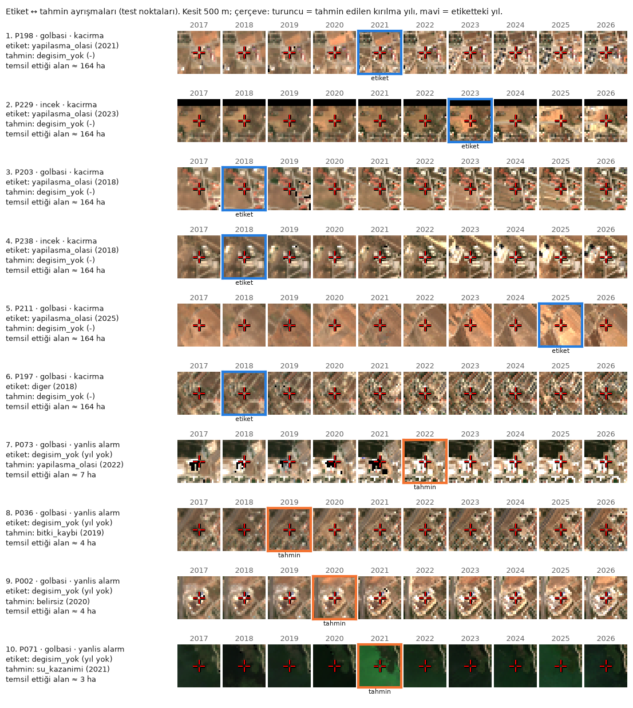
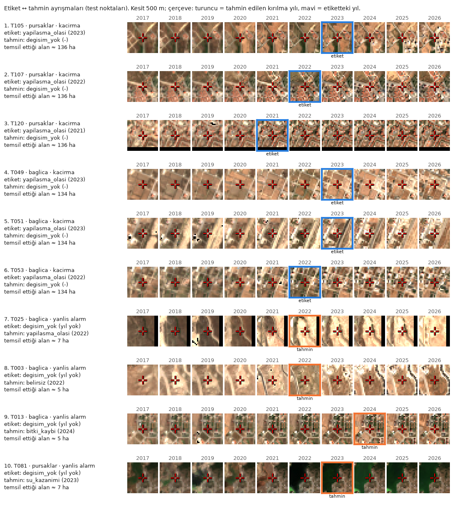

# TR-ChangeWatch — Teknik rapor

Bu rapor [README](../README.md)'deki özetin ayrıntılarıdır: bulgular, tüm doğrulama tabloları, deneyler, yayın kararları, aylık izleme, komut listesi ve sınırlamalar. Kapsam ve teknik kararlar: [PROJECT_SPEC.md](../PROJECT_SPEC.md).

Terimler: **AOI** (area of interest) = inceleme bölgesi; **kırılma** = bir pikselin 2017–2026 zaman serisindeki kalıcı basamak; **Olofsson** = alan ağırlıklı doğruluk ve alan kestirimi (Olofsson vd. 2014); **GA** = güven aralığı; **MMU** = en küçük haritalama birimi (0,5 ha).

## İçindekiler

- [Özet](#özet)
- [Geliştirme ve test bölgeleri](#geliştirme-ve-test-bölgeleri)
- [Yöntem](#yöntem)
- [Özet sonuç tablosu](#özet-sonuç-tablosu)
- [Bulgu: NDBI ve BSI ters çalışıyor](#bulgu-ndbi-ve-bsi-ters-çalışıyor)
- [Yöntem geçişi: ardışık yıl çiftlerinden kırılma noktasına](#yöntem-geçişi-ardışık-yıl-çiftlerinden-kırılma-noktasına)
- [Bulgu: Gölbaşı su alanındaki artışın çoğu çatı ve seralardan](#bulgu-gölbaşı-su-alanındaki-artışın-çoğu-çatı-ve-seralardan)
- [Doğrulama sonuçları (geliştirme bölgeleri)](#doğrulama-sonuçları-geliştirme-bölgeleri)
  - [Su doğrulama seti](#su-doğrulama-seti)
  - [Deneyler (E1, E3–E5)](#deneyler-e1-e3e5)
  - [Ayrışmalar](#ayrışmalar)
- [Görülmemiş bölgelerde test](#görülmemiş-bölgelerde-test)
- [v1 yayın kararları](#v1-yayın-kararları)
- [Web haritası](#web-haritası)
- [Aylık izleme](#aylık-izleme)
- [Komutlar](#komutlar)
- [Bilinen sınırlamalar](#bilinen-sınırlamalar)
- [v2 (v1 kapsamı dışında)](#v2-v1-kapsamı-dışında)
- [Veri ve atıflar](#veri-ve-atıflar)

## Özet

TR-ChangeWatch, Ankara'daki dört küçük bölgede (İncek–Kızılcaşar, Gölbaşı, Bağlıca–Etimesgut, Pursaklar) Sentinel-2 L2A görüntülerini Planetary Computer'dan yalnızca bölge penceresiyle okur, her yıl için aynı yaz penceresinden bulut maskeli medyan kompozit üretir, her pikselin 2017–2026 serisinde tek bir kalıcı kırılma arar ve kırılmaları doku, NDVI ve diğer spektral kanıtlarla yapılaşma / bitki kaybı / belirsiz olarak sınıflandırır. Sonuçlar kendi kör etiketlediğimiz tabakalı rastgele noktalarla, alan ağırlıklı (Olofsson) yöntemle ölçüldü; yöntem iki geliştirme bölgesinde tasarlanıp donduruldu ve **hiç görmediği iki bölgede ayar değiştirilmeden test edildi**. Değişimin kendisi yeni bölgelere genelleşiyor (kesinlik %61, duyarlılık %81); yapılaşma türü ise zayıflıyor (F1 %72 → %50) ve 20 m çözünürlük gereği küçük yapılar kaçırılıyor. Harita bir tahmindir; her poligon kanıt alanlarıyla birlikte yayınlanır, son 3 ayın ön uyarıları her ay otomatik güncellenir.

## Geliştirme ve test bölgeleri

Yöntem tasarımı ve eşik denemeleri yalnızca **geliştirme AOI'lerinde** yapılır: `incek` (yapılaşma, bitki kaybı) ve `golbasi` (su kuralı, Mogan Gölü). **Test AOI'leri** `baglica` ve `pursaklar`, yöntem dondurulana kadar hiç çalıştırılmaz (indirme dahil); dondurulduktan sonra hiçbir ayar değiştirilmeden çalıştırılır. Böylece test AOI'lerindeki sonuçlar, yöntemin o bölgelere göre ayarlanmamış olduğunu gösterir.

## Yöntem



- **Kompozit:** her yıl 1 Temmuz–15 Eylül; SCL ile maskelenmiş sahnelerin piksel bazlı medyanı; AOI'de geçerli pikseli %20'nin altındaki sahneler atılır.
- **Kırılma:** her piksel için bantlar ve doku kendi gürültülerine bölünür (z-ölçek); 2017–2026 serisinde parça içi sapmayı en aza indiren tek kırılma yılı seçilir; basamak gürültünün 3 katını aşmalı. Kırılmadan sonra en az 2 yıl → kalıcı katman; yalnızca son yılda (2026) → izleme katmanı.
- **Tür:** anlamlı doku artışı → `yapilasma_olasi`; anlamlı NDVI düşüşü (doku artışı yok) → `bitki_kaybi`; ikisi de değil → `belirsiz`. Her poligonda `dNDVI`, `dNDBI`, `dBSI`, `dMNDWI`, `doku_artisi`, sinyal türü, skor, gözlem sayısı ve `dusuk_gozlem` kanıtları tutulur.
- **Doğrulama:** tabakalı rastgele örnekleme (tabaka = harita sınıfı), kör etiketleme arayüzü (çiplerde tahmin/tabaka gizli), %30 kalibrasyon / %70 test; alan ağırlıklı doğruluk ve alan kestirimi (Olofsson vd. 2014).

Tüm eşikler `config/settings.yaml` içinde; kapsam ve teknik kararlar [PROJECT_SPEC.md](../PROJECT_SPEC.md)'de.

## Özet sonuç tablosu

Kör etiketlenmiş test noktalarında, nokta bazlı. Geliştirme satırları İncek + Gölbaşı'nın 194 test noktası (kalibrasyon noktaları ayrı tutuldu); son satır yöntemin hiç çalıştırılmadığı Bağlıca + Pursaklar'ın 110 noktası. Ayrıntılar: [deneyler](#deneyler-e1-e3e5), [görülmemiş bölgelerde test](#görülmemiş-bölgelerde-test).

| varyant | yanlış alarm oranı | değişim kesinliği / duyarlılığı | yapılaşma kesinliği / duyarlılığı | yapılaşma F1 | kırılma yılı tam / ±1 |
|---|---|---|---|---|---|
| E1 · tek sahne (ardışık yıl çifti) | %53 | %47 / %84 | %73 / %32 | %44 | %25 / %61 |
| E1 · medyan kompozit + kalıcılık (ardışık yıl çifti) | %49 | %51 / %81 | %76 / %41 | %53 | %40 / %75 |
| **E1 · kırılma noktası (v1 yöntemi)** | **%43** | **%57 / %85** | **%71 / %72** | **%72** | **%66 / %84** |
| E3 · harmonizasyon kapalı | %59 | %41 / %87 | %75 / %12 | %21 | %21 / %51 |
| E4 · eski NDBI/BSI yapılaşma kuralı | %43 | %57 / %85 | %34 / %13 | %19 | %66 / %84 |
| E5 · yıllık normalize doku | %42 | %58 / %78 | %73 / %63 | %68 | %67 / %86 |
| **Görülmemiş bölgeler (v1 yöntemi, ayar değişmeden)** | **%39** | **%61 / %81** | **%51 / %49** | **%50** | **%53 / %81** |

Alan ağırlıklı (Olofsson) genel doğruluk geliştirme bölgelerinde %79 ± 9, görülmemiş bölgelerde %74 ± 12. Haritadaki yapılaşma gerçek yapılaşmanın yalnızca bir kısmı: kestirilen yapılaşma alanı geliştirme bölgelerinde 2 239 ± 982 ha (haritada 564 ha), görülmemiş bölgelerde 2 960 ± 1 447 ha (haritada 414 ha).

## Bulgu: NDBI ve BSI ters çalışıyor

Literatürde yapılaşma için sık kullanılan "NDBI artışı" İncek'te geçerli değil. Bozkır ve sürülmüş tarla, NDBI ve BSI'de yerleşimden **daha yüksek** değer veriyor (yerleşimde bahçe, ağaç ve kiremit çatı var). Bu yüzden bozkırın konuta dönüşmesi NDBI ve BSI'yi **düşürüyor**.

| 2024 yaz kompoziti (medyan) | NDVI | NDBI | BSI |
|---|---|---|---|
| Yerleşim (doku > 0,05) | 0,160 | 0,014 | 0,078 |
| Bozkır/tarla (doku < 0,01) | 0,205 | 0,121 | 0,174 |

| 2017→2024 farkı (medyan) | dNDVI | dNDBI | dBSI | dMNDWI |
|---|---|---|---|---|
| Doku düşükten yükseğe çıkan pikseller (AOI'nin %5,4'ü) | −0,071 | −0,040 (%64'ü düşüş) | −0,038 (%69'u düşüş) | +0,111 |
| Dokusu iki yılda da düşük kalan pikseller | +0,013 | −0,005 | −0,002 | −0,005 |

Bu ölçüm keşif amaçlıdır; doğrulama noktası kullanılmadı ve eşik ayarlanmadı. Sonuç olarak yapılaşma kuralının birincil kanıtı **doku artışı + kalıcılık** oldu; NDVI, NDBI ve BSI farkları işaretli değerleriyle kanıt alanı olarak tutuluyor. İki kuralın doğrulama noktalarındaki karşılaştırması deney **E4**'te (NDBI/BSI kuralı yapılaşmanın %13'ünü, doku kuralı %72'sini yakaladı).

## Yöntem geçişi: ardışık yıl çiftlerinden kırılma noktasına

İlk yöntem her ardışık yıl çiftinde (2017→2018 … 2025→2026) CVA büyüklüğü ve doku farkını Otsu ile eşikleyip bir sonraki yılda "geri dönmüyor mu" diye kalıcılık arıyordu. İncek'te iki yapısal sorun çıktı:

- **Otsu yıllık farklarda gürültüyü bölüyor.** Gerçek değişim alanın birkaç yüzdesiyken her yıl alanın %7–19'u aday oldu; 9 yılda AOI'nin %47'si en az bir kez "değişti".
- **Kalıcılık testi tarla rotasyonunu elemiyor.** Her yıl farklı ürün ekilen tarla "geri dönmediği" için kalıcı sayıldı.

Bu yüzden LandTrendr/BFAST'ın basitleştirilmiş bir hâline geçildi: her pikselin 2017–2026 serisinde (bantlar + doku, her biri kendi gürültüsüyle z-ölçekli) tek bir basamak aranır; kırılma yılı parça içi sapmayı en aza indiren yıldır, aday için basamak gürültünün k katını aşmalıdır. Yıl yıl değişen tarlanın parça içi yayılımı büyük olduğu için skoru düşük kalır; kalıcılık yöntemin içindedir.

| İncek, 2017–2026 | Ardışık çift | Kırılma noktası |
|---|---|---|
| Yapılaşma (ha) | 1 545 | 417 (+ 2026 izleme 117) |
| Tüm türler, ayak izi (ha) | 2 826 | 518 |
| Doğrudan 2017→2024 doku artışlı adayla örtüşme (yöntemin içeride kalan payı) | %36 | %59 |

Ardışık çift yöntemi silinmedi (`--method pairs`); doğrulama noktalarındaki karşılaştırması deney E1'de.

## Bulgu: Gölbaşı su alanındaki artışın çoğu çatı ve seralardan

İlk su kuralı "MNDWI > 0 olan her piksel su" diyordu. Gölbaşı'nda bu seri 2017→2025 arasında **+37,6 ha** artış gösteriyordu. Su yalnızca ≥ 5 ha bağlı su kütlelerine ait pikseller olarak tanımlanınca artış **+12,6 ha**'ya iniyor. Aradaki fark, MNDWI > 0 veren küçük parçalardan (çatı, sera, gölcük) geliyor ve bu parçalar yıllar içinde 8 ha'dan 33 ha'ya büyüyor; büyük olasılıkla Gölbaşı'ndaki yapılaşmayla birlikte.

| Yıl | Su (≥ 5 ha kütleler) | Eski seri (tüm MNDWI > 0) | Elenen küçük parçalar |
|---|---|---|---|
| 2017 | 521 | 529 | 8 |
| 2021 | 546 | 561 | 15 |
| 2024 | 528 | 559 | 31 |
| 2025 | 534 | 567 | 33 |

Grafik `changewatch water --aoi golbasi` ile üretilir (eski seri kesikli). 2021'deki sıçramanın bir kısmı göl suyunun renk değişiminden (alg/bulanıklık) gelebilir; göl içi renk değişimi su kazanımı sayılmaz (su kütlelerinin iç delikleri doldurulur, kazanım/kayıp yalnızca kıyı şeridinde aranır).

## Doğrulama sonuçları (geliştirme bölgeleri)

Kör etiketlenmiş **test** noktaları (kalibrasyon noktaları kullanılmadı, eşik ayarı yapılmadı; yöntem dondurulmuş). 197 test noktasından 3'ü "emin değilim" olarak işaretlendi ve metriklere katılmadı → n = 194. Harita: kırılma yöntemi, kalıcı katman. `changewatch validate` ile üretilir (`validation/metrics_test.json`).

| | incek | golbasi | birlikte |
|---|---|---|---|
| n (test) | 116 | 78 | 194 |
| Değişim / değişim yok: TP · FN · FP · TN | 55 · 8 · 24 · 29 | 17 · 5 · 31 · 25 | 72 · 13 · 55 · 54 |
| Değişim kesinliği / duyarlılığı | %70 / %87 | %35 / %77 | %57 / %85 |
| Yapılaşma kesinliği / duyarlılığı (nokta bazlı) | %71 / %71 | %71 / %75 | %71 / %72 |
| Olofsson genel doğruluk (± %95 GA) | %76 ± 12 | %82 ± 13 | %79 ± 9 |
| Haritadaki yapılaşma (ha) | 418 | 147 | 564 |
| Kestirilen yapılaşma alanı (ha, ± %95 GA) | 1 340 ± 682 | 861 ± 700 | 2 239 ± 982 |
| Yapılaşma üretici doğruluğu, alan ağırlıklı | %22 ± 12 | %12 ± 10 | %18 ± 8 |
| Kırılma yılı isabeti: tam / ±1 yıl | %69 / %83 (54) | %56 / %88 (16) | %66 / %84 (70) |

Yıl isabeti yalnızca etiketinde yıl girilmiş ve hem etiketin hem haritanın "değişim" dediği noktalarda hesaplanır (parantez içinde n).

**Okuma:** Haritanın yapılaşma dediği yerlerin ~%71'i gerçekten yapılaşma; ama alan ağırlıklı kestirime göre gerçek yapılaşmanın yalnızca ~%18'i haritada.

**Alan kestiriminin güven aralığı geniş ve bunu açıkça söylüyoruz:** iki AOI'de yapılaşma alanı **2 239 ± 982 ha** (%95 GA), yani kabaca 1 250–3 200 ha; haritadaki yapılaşma ise 564 ha. Neden:
- **"Değişim yok" tabakasındaki kaçırmalar.** Bu tabaka 10 963 ha ve yalnızca 70 test noktası var; her nokta ~164 ha temsil ediyor. Etiketlemede bu noktaların 11'i yapılaşma çıktı. Kestirilen yapılaşma alanının çoğu, haritanın görmediği bu kaçırmalardan geliyor; aralığın genişliği de 70 noktada 11 kaçırmanın binom belirsizliği (bir nokta fazla ya da eksik ≈ ±164 ha).
- **Alt-piksel yapılar.** Kaçırmaların bir kısmı mevcut yerleşim içindeki küçük, dağınık yapılar (tek bina, ek yapı, dar yol): 20 m pikselde (400 m²) ve 0,5 ha MMU'da kırılma olarak görünmüyorlar. Çalışma ızgarası gereği bunlar yöntemin kapsamı dışında (bkz. "iddia etmiyoruz: tek tek bina tespiti"), ama etiketleyici onları "yeni yapı" olarak görüyor.
- Güven aralığı ancak "değişim yok" tabakasında daha çok nokta etiketlenerek daraltılabilir; yöntem değiştirilerek değil (yöntem dondurulmuş).

### Su doğrulama seti

Gölbaşı'ndaki tüm su poligonları (16 poligon, 5,2 ha; kalıcı + izleme) birer noktayla etiketlendi. Bu set bir sayımdır, alan kestirimine katılmaz.

| tahmin türü | poligon | alan (ha) | etiket "değişim var" | etiket "değişim yok" |
|---|---|---|---|---|
| su_kazanimi | 7 | 2,88 | 0 | 7 |
| su_kaybi | 3 | 0,68 | 0 | 3 |
| sulak_alan_belirsiz | 6 | 1,68 | 0 | 6 |

**16 poligonun 16'sı yanlış alarm**: su katmanının kesinliği bu sette %0. Etiketlemede görülen iki neden:
- **Göl içi renk değişimi (alg/bulanıklık):** suyun yeşillendiği yıllarda MNDWI değişiyor; kıyıya yakın pikseller su kazanımı/kaybı olarak işaretleniyor.
- **Sazlık/kıyı bitkisi:** kıyı sazlığı yıldan yıla suyla dönüşümlü görünüyor ama kalıcı bir değişim yok.

Bu yüzden **su değişim poligonları v1'de yayınlanmıyor** ([v1 yayın kararları](#v1-yayın-kararları)). Su katmanı hesaplanmaya devam ediyor çünkü su pikselleri yapılaşma katmanından düşülüyor (dondurulmuş hat değişmedi). Yıllık göl/su alanı serisi (≥ 5 ha su kütleleri) grafik olarak yayınlanıyor; bu seri poligonlardan farklı olarak kıyı şeridindeki küçük salınımlara duyarsız.

### Deneyler (E1, E3–E5)

`changewatch experiments` ile üretilir (`validation/experiments_test.json`). Aynı 194 test noktası; nokta bazlı (tabakalar temel haritadan çekildiği için diğer varyantlara Olofsson ağırlığı uygulanmaz). E2 (mevsim penceresi) v2'ye ertelendi.



| deney | varyant | genel doğruluk | yanlış alarm oranı | değişim kesinliği / duyarlılığı | yapılaşma kesinliği / duyarlılığı | yapılaşma F1 | yıl tam / ±1 |
|---|---|---|---|---|---|---|---|
| E1 | tek sahne (ardışık çift, kalıcılık yok) | %28 | %53 | %47 / %84 | %73 / %32 | %44 | %25 / %61 |
| E1 | medyan kompozit (ardışık çift, kalıcılık yok) | %30 | %52 | %48 / %86 | %72 / %39 | %50 | %37 / %70 |
| E1 | kompozit + kalıcılık (ardışık çift) | %38 | %49 | %51 / %81 | %76 / %41 | %53 | %40 / %75 |
| E1 | **kırılma noktası (temel)** | **%56** | **%43** | %57 / %85 | %71 / %72 | **%72** | **%66 / %84** |
| E3 | harmonizasyon kapalı | %8 | %59 | %41 / %87 | %75 / %12 | %21 | %21 / %51 |
| E4 | eski NDBI/BSI kuralı | %34 | %43 | %57 / %85 | %34 / %13 | %19 | %66 / %84 |
| E5 | normalize doku | %56 | %42 | %58 / %78 | %73 / %63 | %68 | %67 / %86 |

- **E1:** Tek sahneden kırılma yöntemine geçiş yanlış alarm oranını %53'ten %43'e indiriyor; asıl kazanç yapılaşma duyarlılığında (%32 → %72) ve yıl isabetinde (%25 → %66). Kalıcılık kuralı ardışık çift yönteminde yanlış alarmı yalnızca 3 puan azaltıyor.
- **E3:** Harmonizasyon kapalıyken yanlış alarm %59'a çıkıyor ve yapılaşma duyarlılığı %12'ye düşüyor; değişimlerin çoğu başka türe kayıyor.
- **E4:** Değişim/değişim yok kararı aynı (aynı kırılma maskesi); yalnızca tür kuralı farklı. NDBI/BSI kuralı yapılaşmanın %13'ünü yakalıyor, doku kuralı %72'sini: İncek'te NDBI'nin ters çalıştığı bulgusu doğrulama noktalarında da görülüyor.
- **E5:** Normalize doku yanlış alarmı değiştirmiyor (%42 / %43), yapılaşma duyarlılığını düşürüyor (%72 → %63). Yıl isabetinde fark ±1–2 puan: ham doku korunuyor.

### Ayrışmalar

Tüm test noktalarındaki ayrışmalar: yanlış alarm 55 (tahmin bitki kaybı 20, belirsiz 18, yapılaşma 16, su kazanımı 1), kaçırma 13 (yapılaşma 11, diğer 2), tür hatası 18. En önemli 10 ayrışma (temsil ettiği alana göre seçildi; her değişim/değişim yok hata grubundan en az bir nokta) aşağıda; çerçeveler tahmin edilen (turuncu) ve etiketteki (mavi) yılı gösterir.



## Görülmemiş bölgelerde test

Yöntem geliştirilirken hiç çalıştırılmamış iki AOI'de (Bağlıca, Pursaklar) dondurulmuş v1 ayarlarıyla, **hiçbir ayar değiştirilmeden** test edildi. AOI başına ayrı ~60 noktalık tabakalı örneklem (hepsi test), kör etiketleme; sonuçlara bakılarak düzeltme yapılmadı. `changewatch validate --set test_aoi [--aoi baglica|pursaklar]` ile üretilir (`validation/metrics_test_aoi*.json`).

| | incek | golbasi | **geliştirme birlikte** | baglica | pursaklar | **test birlikte** |
|---|---|---|---|---|---|---|
| n (kesin etiket) | 116 | 78 | 194 | 55 | 55 | 110 |
| "Emin değilim" (metriklere katılmadı) | 1 | 2 | 3 | 5 | 5 | 10 |
| Değişim kesinliği / duyarlılığı | %70 / %87 | %35 / %77 | %57 / %85 | %74 / %78 | %49 / %85 | %61 / %81 |
| Yapılaşma kesinliği / duyarlılığı / F1 (nokta bazlı) | %71 / %71 / %71 | %71 / %75 / %73 | %71 / %72 / %72 | %62 / %46 / %53 | %36 / %56 / %43 | %51 / %49 / %50 |
| Olofsson genel doğruluk (± %95 GA) | %76 ± 12 | %82 ± 13 | %79 ± 9 | %65 ± 19 | %82 ± 15 | %74 ± 12 |
| Haritadaki yapılaşma (ha) | 418 | 147 | 564 | 242 | 172 | 414 |
| Kestirilen yapılaşma alanı (ha, ± %95 GA) | 1 340 ± 682 | 861 ± 700 | 2 239 ± 982 | 2 056 ± 1 136 | 903 ± 896 | 2 960 ± 1 447 |
| Kırılma yılı isabeti: tam / ±1 yıl (n) | %69 / %83 (54) | %56 / %88 (16) | %66 / %84 (70) | %55 / %77 (22) | %50 / %86 (14) | %53 / %81 (36) |

Notlar:
- "Değişim" satırı haritadaki tüm türleri (bitki kaybı, belirsiz ve su dahil) değişim sayar. Yıl isabeti yalnızca etiketinde yıl girilmiş ve hem etiketin hem haritanın "değişim" dediği noktalarda hesaplanır.
- Test AOI'leri birbirinden bağımsız örneklendiği için "test birlikte" sütunundaki alan ağırlıklı değerler AOI kestirimlerinin toplamıdır (AOI = üst tabaka; alanlar ve varyanslar toplanır). Geliştirme AOI'leri ortak tabakalarla örneklendiğinden orada ortak tabaka alanları kullanıldı.
- Test örnekleminde "değişim yok" tabakası AOI başına 21 noktayla ~5 500 ha'yı temsil ediyor (nokta başına ~260 ha); alan kestiriminin güven aralıkları bu yüzden geliştirme setindekinden geniş.

**Okuma:** Değişim/değişim yok ayrımı görülmemiş bölgelerde geliştirme setine yakın (kesinlik %61, duyarlılık %81). Yapılaşma türünde ise düşüş var: kesinlik %71 → %51, F1 %72 → %50. Pursaklar'da yapılaşma tahminlerinin 14'ünün 7'si referansta değişim yok. Alan ağırlıklı kestirime göre iki test AOI'sinde gerçek yapılaşmanın yalnızca ~%7'si haritada (geliştirme setinde ~%18); haritadaki 414 ha'ya karşı kestirim 2 960 ± 1 447 ha. Hata paneli aşağıda.



**Yorum:** Değişim tespiti görülmemiş bölgelere genelleşiyor; yapılaşma türü ise genelleşmiyor (F1 %72 → %50). Etiketlemede görülen neden bir **alan kayması**: geliştirme AOI'lerinde (İncek, Gölbaşı) yapılaşma çoğunlukla açık araziye kurulan yeni sitelerden ve yollardan oluşuyordu; test AOI'lerinde ise çoğunlukla mevcut sık yerleşimin içindeki küçük eklerden (tek bina, ek yapı, boş parsel doldurma) oluşuyor. Bunlar 20 m pikselde ve 0,5 ha MMU'da ya hiç kırılma vermiyor (kaçırma) ya da zayıf doku sinyaliyle "belirsiz" sınıfına düşüyor (tür hatası). Dondurulmuş yöntemde düzeltme yapılmadı; çözüm yönleri (daha yüksek çözünürlüklü veri, derin öğrenme tabanlı değişim tespiti) v2 listesinde.

**Bulgu: Pursaklar'da su kazanımı doğru çıktı.** Pursaklar'daki su kazanımı tabakasının 8 test noktasının 7'si referansta da su kazanımı (kesinlik %88; kaçırılan su kazanımı yok; 2022'de oluşan yeni bir su kütlesi, su alanı serisinde 0 → ~50–59 ha). Gölbaşı su setinde ise 16 poligonun 0'ı doğruydu. Fark, değişimin niteliğinden geliyor: Pursaklar'da kuru araziden açık suya net ve kalıcı bir geçiş var; Gölbaşı'nda ise mevcut gölün kıyısındaki alg/renk değişimi ve sazlık salınımı su kazanımı/kaybı olarak işaretleniyordu. Su katmanı yeni oluşan su kütlelerini yakalayabiliyor, ama mevcut göllerin kıyısındaki yanlış alarmları ayıramıyor. Su değişim poligonlarını yayınlamama kararı (v1 yayın kararları) test sonuçlarından önce verildi ve değişmedi; v1'de su poligonları yayınlanmıyor, yalnızca su alanı serisi grafiği yayınlanıyor.

## v1 yayın kararları

Faz 3 doğrulamasından sonra alındı; yöntem ve eşikler değişmedi, yalnızca neyin nasıl gösterileceği belirlendi.

| katman | web haritasında | gerekçe (test noktaları) |
|---|---|---|
| `yapilasma_olasi` | **varsayılan açık** | kesinlik %71, nokta bazlı duyarlılık %72 |
| `bitki_kaybi` | "deneysel", varsayılan kapalı | kullanıcı doğruluğu %0 (25 tahminin 20'si referansta değişim yok) |
| `belirsiz` | "deneysel", varsayılan kapalı | kullanıcı doğruluğu %0 (25 tahminin 18'i referansta değişim yok) |
| `su_kazanimi`, `su_kaybi`, `sulak_alan_belirsiz` | **yayınlanmıyor** | Gölbaşı su seti 16/16 yanlış alarm |
| göl/su alanı serisi | grafik olarak | ≥ 5 ha su kütleleri; poligon değil |

## Web haritası

Statik Leaflet sayfası `docs/` altında (GitHub Pages). Yerelde denemek için (sayfa `fetch` kullandığı için dosyayı doğrudan açmak yerine yerel sunucu gerekir):

```bash
changewatch publish                          # docs/data'yı önbellekten yeniden üretir (yalnızca veri değiştiyse)
python -m http.server 8000 --directory docs  # sonra tarayıcıda: http://localhost:8000/#incek
```

Sayfada: bölge ve değişim yılı aralığı seçici; yapılaşma katmanı varsayılan açık, bitki kaybı ve belirsiz "deneysel" etiketiyle kapalı; 2026 değişimleri ayrı "izlemede" katmanı; seçilen yılların kompozitleriyle önce/sonra kaydırıcı; poligona tıklayınca tür, yıl, alan, güven ve kanıtlar; yıllara göre yapılaşma ve su alanı serisi grafikleri; "Yöntem ve doğruluk" paneli. Altlık: uydu (Esri World Imagery) veya OpenStreetMap. Su değişim poligonları yayınlanmaz ([v1 yayın kararları](#v1-yayın-kararları)).

## Aylık izleme

`changewatch monitor` (ve `.github/workflows/monthly.yml`, her ayın 5'inde + elle tetikleme) son 3 tam ayı önceki yılın aynı 3 ayıyla karşılaştırır (mevsimsel hizalı). İki dönemin medyan kompozitleri arasında **spektral değişim** (CVA büyüklüğü, AOI içi sağlam z > 3) **ve 10 m doku artışı** (sağlam z > 3) olan, yeşillenme olmayan ve 0,5 ha'dan büyük alanlar "ön uyarı" olarak `docs/data/<aoi>/monitor.geojson`'a yazılır; haritada yıllık katmandan ayrı, "doğrulanmadı" etiketiyle gösterilir. Doku koşulu olmadan tarla sürümü/hasat farkları ön uyarıların neredeyse tamamını oluşturuyordu (Pursaklar, Ağu–Eki 2026: 135 poligon / 568 ha → doku koşuluyla 7 poligon / 6,4 ha). Ön uyarı kuralı etiketli noktalarla kalibre edilmedi ve doğruluğu ölçülmedi.

- **Kapsama:** AOI'nin iki dönemde de geçerli (bulutsuz, karsız) piksel oranı `stats.json` → `aylik_izleme.kapsama` alanına yazılır; %60'ın altındaysa (kış) analiz atlanır ve nedeni yazılır.
- **Planetary Computer 429/5xx:** STAC araması ve her sahne okuması üstel beklemeyle (10, 20, 40, 80, 160 s) yeniden denenir. İsteğe bağlı `PC_SDK_SUBSCRIPTION_KEY` secret'ı tanımlanabilir.
- **Commit:** iş yalnızca `docs/data/*/monitor.geojson` ve `docs/data/*/stats.json` dosyalarını, 1 MB sınırı kontrolünden sonra commit'ler; GeoTIFF ve önbellek CI'da hiç diske yazılmaz.
- **Süre:** yerelde (ev bağlantısı) AOI başına ~2–2,5 dk (iki dönem × ~20 çekim × 20 m + 10 m pencereli okuma). GitHub runner'da bağımlılık kurulumu (rasterio, geopandas, odc-stac, scikit-image tekerlekleri) ~2–4 dk; 4 AOI ile bir çalıştırma **tahminen 10–20 dk**, 429 beklemeleriyle 30 dk'ya çıkabilir (iş zaman aşımı 90 dk).
- **60 gün kuralı:** GitHub, public repolarda 60 gün boyunca depoda etkinlik olmazsa zamanlanmış iş akışlarını otomatik olarak devre dışı bırakır. Bu durumda gelen uyarı e-postasından sonra **Actions → monthly → "Enable workflow"** ile yeniden etkinleştirin; elle tetikleme (`Run workflow`) her zaman çalışır.

## Komutlar

```bash
changewatch check-aois                                  # AOI alan/sınır kontrolü
changewatch scenes      --aoi incek --years 2017-2026   # sahne/bulut/baseline özeti (indirme yok)
changewatch fetch       --aoi incek                     # AOI penceresini önbelleğe indir (20 m + 10 m B08)
changewatch composite   --aoi incek                     # harmonizasyon + SCL maskesi + medyan kompozit + sahne bazında doku
changewatch indices     --aoi incek --years 2017 2024   # NDVI, NDBI, MNDWI, BSI, doku (GeoTIFF + PNG)
changewatch detect      --aoi incek                     # kırılma noktası (varsayılan) → changes.geojson + izleme.geojson
changewatch detect      --aoi incek --method pairs      # ardışık yıl çiftleri (E1 karşılaştırması için)
changewatch water       --aoi golbasi                   # yıllık su maskesi, su alanı serisi ve grafiği
changewatch evaluate    --aoi incek --direct-years 2017 2024  # tür × yıl, yöntemler arası, tutarlılık
changewatch sample                                      # Faz 3: tabakalı örnekleme, labels.csv şablonu, çipler, QGIS yükleyici
changewatch label-prep                                  # kör etiketleme çipleri + Gölbaşı su doğrulama seti
changewatch sample --set test_aoi                       # test AOI'leri (baglica, pursaklar): AOI başına ~60 nokta, hepsi test, ayrı dosyalar + kör çipler
changewatch label [--set su|test_aoi]                   # kör etiketleme arayüzü (talimat: validation/ETIKETLEME.md)
changewatch validate [--aoi incek]                      # AOI'ler ayrı ve birlikte: karışıklık matrisleri, Olofsson, su seti, hata paneli
changewatch experiments [--build]                       # E1, E3–E5 varyantları ve nokta tahminleri (E2 v2'de)
changewatch validate --set test_aoi [--aoi baglica]     # görülmemiş bölge testi
changewatch publish                                     # web haritası verisi: docs/data (< 50 MB, PNG ≤ 500 KB)
```

## Bilinen sınırlamalar

- **Tek tek bina tespiti değil; küçük yapılar kaçırılır.** Çalışma ızgarası 20 m (piksel 400 m²), MMU 0,5 ha. Mevcut yerleşim içindeki tek bina, ek yapı ve dar yollar kırılma üretmiyor; alan ağırlıklı kestirime göre gerçek yapılaşmanın geliştirme bölgelerinde ~%18'i, görülmemiş bölgelerde ~%7'si haritada.
- **Alan kayması: yapılaşma türü yeni bölgelerde zayıflıyor** (F1 %72 → %50). Yöntem açık araziye kurulan yeni sitelerin olduğu bölgelerde tasarlandı; sık yerleşim içindeki dolgu yapılaşmasında doku sinyali zayıf kalıyor ve parçalar "belirsiz"e düşüyor.
- **Bitki kaybı ve belirsiz katmanları deneysel:** test noktalarında kullanıcı doğrulukları %0; haritada varsayılan kapalı.
- **Aylık ön uyarılar doğrulanmadı:** kural etiketli noktalarla kalibre edilmedi; yalnızca yıllık analizde doğrulanana kadar ipucu olarak gösterilir. Kış dönemlerinde kapsama eşiği (%60) şimdiye kadarki çalıştırmalarda tetiklenmedi (İncek, Kas 2025–Oca 2026: %100); atlama yolu yalnızca birim testleriyle doğrulandı.
- **Güven düzeyi** (yüksek/orta/düşük) kural tabanlı bir tahmindir (kırılmadan sonraki yıl sayısı), gerçek dünyadaki kesinlik değildir.

- **04.00 öncesi parlak yüzeyler → sahte 2022 kırılması (P073 tipi).** 02.12/03.00 baseline'lı sahnelerde (2017–2021) parlak yüzeyler bulut sayılıp maskeleniyor; piksel 2022'de (baseline 04.00) ilk kez gözlenince seri orada basamak yapıyor ve yöntem değişmemiş bir yüzeye 2022 yapılaşması diyor. Test noktası P073 bunun örneği (2017–2021 çiplerinde maskeli pikseller, kırılma tam 2022). Test sonuçlarına bakılarak düzeltme yapılmadı; v2 listesinde. `dusuk_gozlem` kanıt alanı bu poligonları işaretler.

- **04.00 öncesi baseline'larda parlak yüzeyler bulut sayılabiliyor.** 2017–2021 sahneleri (processing baseline 02.12 ve 03.00) bulutsuz günlerde bile parlak yüzeyleri (şantiye, yol, parlak çatı) SCL 8/9 (orta/yüksek olasılıklı bulut) olarak sınıflandırabiliyor. İncek yaz kompozitlerinde 2017–2021 arasında AOI piksellerinin %0,05–0,35'inde 3'ten az geçerli gözlem kaldı (2022 ve sonrasında %0); bu pikseller kompozitte boş bırakılır. Maske değiştirilmedi; bunun yerine her değişim poligonunda `dusuk_gozlem` kanıt alanı (önceki yıl kompozitindeki ortalama geçerli gözlem sayısı ve <3 gözlemli piksel oranı) raporlanır.
- **Son yıl sıçramaları kalıcı katmana sızabilir.** Kalıcı katman en az 2 yıllık "sonrası" ister; yalnızca son yılda (ör. 2026) sıçrayan bir piksel b = 2025'te yarım basamak gösterir ve tek tük pikseller kalıcı katmanda 2025 kırılması olarak geçebilir (MMU tekilleri büyük ölçüde atar). 2026 kırılmaları ayrı `izleme.geojson` katmanındadır.
- **Doku zamanla yukarı kayıyor.** İncek'te AOI doku medyanı 2017→2026 0,021 → 0,030; skoru düşük (değişmeyen) piksellerde de ~%15 artış var. 2025–2026'da sahne sayısı (20–21) 14'e indirildiğinde medyan değişmiyor (0,0289 / 0,0301), yani kayma sahne sayısından kaynaklanmıyor. Nedeni açık (bitki/ağaç büyümesi, yaygın kentleşme veya algılayıcı farkı olabilir); deney E5'te yıllık normalizasyon denendi ve metrikleri iyileştirmedi (ham doku korundu).
- **Tek değişkenli su kırılması gürültüye duyarlı.** MNDWI serisinde kırılma adayı tek başına AOI'nin büyük bir kısmını işaretler (Gölbaşı'nda ~2 000 ha); su katmanında özgüllüğü su kütlesi durumu değişimi ve kıyı şeridi koşulları sağlar (→ ~5 ha).
- **Su değişimleri doğrulama örneklemesinde neredeyse yok.** Su türleri Gölbaşı'nda toplam ~5 ha; tabaka alt sınırı yalnızca ≥ 20 ha tabakalara uygulandığı için su tabakaları 0–1 nokta aldı. Su kuralının doğruluğu bu örneklemeyle ölçülemez; bunun için ayrı su doğrulama seti etiketlendi (yukarıda: 16/16 yanlış alarm, su poligonları v1'de yayınlanmıyor).
- **Su kütlelerinin iç delikleri doldurulur.** Göl içinde MNDWI'yi düşüren renk/bulanıklık değişimi su kazanımı/kaybı üretmesin diye ≥ 5 ha su kütlelerinin içindeki boşluklar su sayılır. Yan etkisi: göl içindeki gerçek adalar da su olarak haritalanır (Mogan'da belirgin ada yok).
- Sahne düzeyindeki bulut oranı (`eo:cloud_cover`) 100×100 km MGRS karesine aittir, AOI'ye değil. Asıl temizlik piksel düzeyinde SCL maskesiyle yapılır.

## v2 (v1 kapsamı dışında)

- **Daha yüksek çözünürlük ve derin öğrenme:** alan kayması ve kaçırılan küçük yapılar için; TorchGeo ile SSL4EO-S12 ön eğitimli Sentinel-2 kodlayıcısı + Siamese başlık (OSCD üzerinde ince ayar), aynı Ankara test noktalarında klasik hatla karşılaştırma; yüksek çözünürlüklü veriyle dolgu yapılaşmasının ölçülmesi.
- **04.00 öncesi parlak yüzey maskesi (P073 tipi hata):** s2cloudless / Cloud Score+ ile alternatif bulut maskesi; yalnızca geliştirme bölgelerinin kalibrasyon noktalarıyla tasarlanır.
- **Su değişim katmanının yeniden tasarımı:** göl içi alg/renk değişimi ve kıyı sazlığı yanlış alarmları (Gölbaşı 16/16), Pursaklar'daki yeni su kütlesi gibi gerçek kazanımları koruyarak; yeni ve ayrı bir su doğrulama setiyle ölçülür.
- **E2 deneyi:** ilkbahar (Mayıs–Haziran) ↔ yaz (Temmuz–Eylül) penceresi.
- **Aylık ön uyarıların doğrulanması** ve kuralın kalibrasyon noktalarıyla ayarlanması.
- Yeni vakalar (Manavgat yangını, Mogan ve Tuz Gölü su alanı), Ankara dışındaki şehirler, ESA WorldCover gibi hazır ürünlerle çapraz kontrol.

## Veri ve atıflar

- **Copernicus Sentinel-2** L2A verisi (ESA). Haritadaki önizlemeler ve tüm türetilmiş ürünler "değiştirilmiş Copernicus Sentinel verisi (2017–2026)" içerir.
- **Microsoft Planetary Computer** — Sentinel-2 L2A STAC kataloğu ve bulut-optimize GeoTIFF erişimi.
- **OpenStreetMap** — harita altlığı © OpenStreetMap katkıcıları (ODbL).
- **Esri World Imagery** — uydu altlığı © Esri ve sağlayıcıları (Maxar, Earthstar Geographics ve GIS kullanıcı topluluğu).
- **Leaflet** (BSD-2) web haritası kütüphanesi.
- Alan ağırlıklı doğruluk: Olofsson, P. vd. (2014). *Good practices for estimating area and assessing accuracy of land change.* Remote Sensing of Environment 148, 42–57.
- Doğrulama etiketleri (`validation/*.csv`) kör etiketleme ile Sentinel-2 kompozitleri ve geçmiş uydu görüntülerine bakılarak üretildi; üçüncü taraf görüntüler repoya konmadı.
